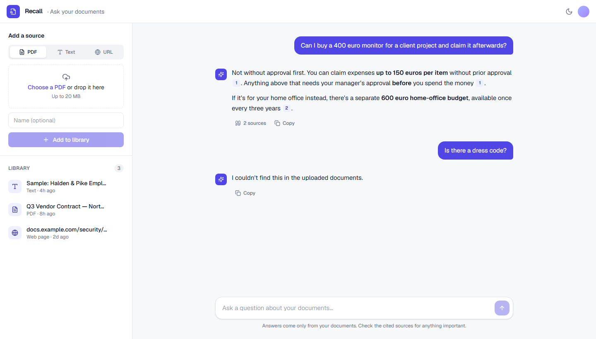
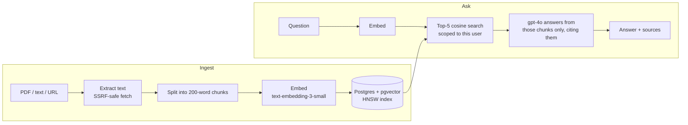
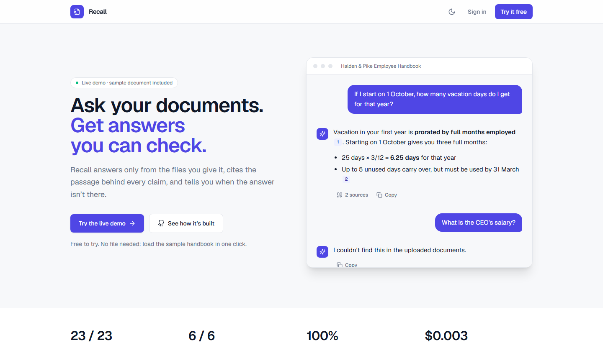
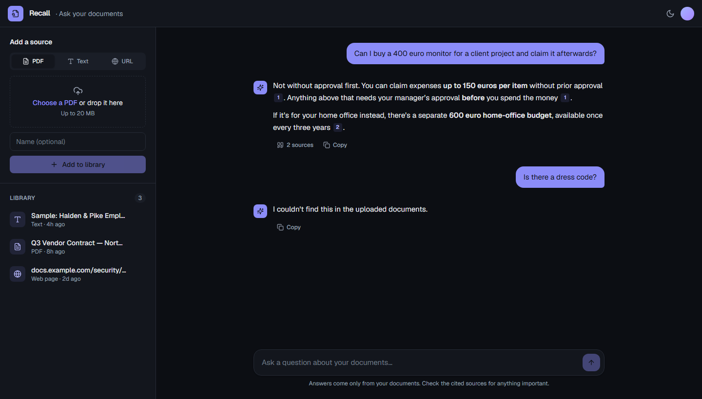

# Recall

**Ask your documents. Get answers you can check.**

Recall answers questions using only the PDFs, text and web pages you give it.
Every claim links to the passage it came from, and when the answer isn't in
your documents, it says so instead of guessing.



| Correct answers | Correctly declined | Answers citing a source | Cost per question |
|:---:|:---:|:---:|:---:|
| **23 / 23** | **6 / 6** | **100%** | **$0.003** |

<sub>A 29-question evaluation set run against the sample handbook with gpt-4o. [Method and full results →](eval/README.md)</sub>

---

## Why this project exists

Most document chatbots are demos: they answer *something*, and nobody checks
whether it was right, whose data it came from, or what it costs. Recall is a
small product built to production standards, and each of those questions has a
tested answer.

## What was hard, and how it was solved

### 1. One user's question must never be answered from another user's documents

The first version ranked similarity across every chunk in the table, so any
user's question could pull text from anyone's documents.

**Fix:** ownership is enforced inside the vector search query. It joins
through `Document` and filters on the signed-in user's id, so there is no code
path that returns unscoped chunks ([lib/rag.ts](lib/rag.ts)).

**Proof:** [tests/ownership.test.ts](tests/ownership.test.ts) runs against a
real Postgres + pgvector in CI. It plants *another* user's chunk that matches
the query **better** than the owner's own, then asserts the search never
returns it. If anyone drops the filter, that test fails with the leak's name
on it.

### 2. "Import from URL" is a server-side request forgery hole by default

If the server fetches any URL a user types, a user can point it at
`localhost`, the internal network, or the cloud metadata endpoint
(`169.254.169.254`).

**Fix:** [lib/safe-fetch.ts](lib/safe-fetch.ts) resolves the host and rejects
private, loopback, link-local, CGNAT and reserved ranges in both IPv4 and IPv6,
including disguised forms like `::ffff:127.0.0.1` and 6to4. It follows
redirects by hand so every hop is re-checked, and caps size and time. The
remaining gap (a DNS-rebinding race) is documented in the code rather than
hidden.

### 3. Evaluation caught a bug a demo never would

[`npm run eval`](eval/README.md) asks 29 questions with known answers,
including 5 that need reasoning and 6 the document can't answer, and grades
the answers deterministically with no LLM judge.

The first run failed *"I was sick for five days. Do I need a doctor's note?"*:
retrieval returned **nothing**, though the handbook answers it directly. With
500-word chunks, the short sick-leave paragraph was diluted and scored exactly
at the similarity cutoff. I measured four chunk sizes before changing anything,
then moved to 200 words. Correct answers went from 22/23 to 23/23, at lower cost
per question.

The same harness settled the model choice. gpt-4o-mini is ~15× cheaper and
matched gpt-4o on every lookup and refusal, but confidently got a proration
calculation wrong (18.75 days instead of 6.25). gpt-4o stays the default, and
the decision is backed by data rather than opinion.

### 4. A public demo can't have an open-ended API bill

Every question and upload is billed to the deployment's OpenAI key.

**Fix:** per-user hourly and daily limits, a global daily ceiling, and a cap on
stored documents ([lib/rate-limit.ts](lib/rate-limit.ts)). Counters live in
Postgres, so there's no extra infrastructure. Each check is a single atomic
`INSERT … ON CONFLICT DO UPDATE … WHERE count < limit`, so concurrent requests
can't race past a limit. A test fires 20 parallel requests at a limit of 5 and
asserts that exactly 5 succeed.

### 5. Failures that don't announce themselves

- **Half-written documents.** Embedding is slow and fails often. Ingest embeds
  first, then writes the document and all its chunks in one transaction, so a
  failure leaves nothing behind ([lib/ingest.ts](lib/ingest.ts)).
- **A vector index Prisma can't see.** The HNSW index can't be expressed in
  `schema.prisma`, so Prisma reads it as drift and offers to drop it. Losing it
  is silent: search stays correct but becomes a full scan. CI applies every
  migration to an empty database and fails the build if the index is missing
  or uses the wrong operator class.
- **Contradictory refusals.** Retrieval always returns the nearest chunks, even
  irrelevant ones. When the model declines, those are no longer shown as
  "sources" under "I couldn't find this".

## How it works



| | |
|---|---|
| App | Next.js 16 (App Router), React 19, Tailwind CSS 4 |
| Auth | Clerk; every route resolves the user server-side |
| Data | Postgres + pgvector on Neon, Prisma 7 |
| Models | OpenAI `text-embedding-3-small`, `gpt-4o` |
| Hosting | Vercel |
| Quality | Typecheck, lint, unit tests, database tests and build on every PR; answer-quality eval on demand |

<details>
<summary>Landing page and dark mode</summary>




</details>

## Run it locally

You need Node 24, a Postgres database with pgvector (Neon and Supabase both
work), an OpenAI API key and a Clerk application.

```bash
npm install
cp .env.example .env      # fill in the values; see the comments in the file
npm run db:deploy         # apply migrations (never `prisma migrate dev`; see CLAUDE.md)
npm run dev
```

Open http://localhost:3000, sign up, and click **Try it with a sample handbook**.

| Command | What it does |
|---|---|
| `npm test` | Unit tests. Set `TEST_DATABASE_URL` to a disposable pgvector database to also run the ownership and rate-limit tests. |
| `npm run eval` | Answer-quality evaluation against the real pipeline. Uses your keys and costs a few cents. Add `-- --model gpt-4o-mini` to compare models. |
| `npm run typecheck` / `npm run lint` | Static checks, also run in CI. |

**More docs:** [provisioning a database](docs/db-provisioning.md) ·
[deploying to Vercel](docs/deploy.md) · [evaluation method](eval/README.md) ·
[project conventions and caveats](CLAUDE.md)

## Known limits and next steps

Listed on purpose: knowing where a system stops is part of building it.

- **Retrieval is tested on one short document.** The eval covers seven chunks.
  Next is a multi-document corpus with near-duplicate distractors, which tests
  ranking much harder.
- **PDFs are capped at 4 MB**, because Vercel rejects function request bodies
  over 4.5 MB before the app sees them. Larger files need uploads that go
  straight to storage, with the function only reading them.
- **Uploads are processed inside the request**, within a 60-second function
  limit. Very large documents should move to a background job.
- **No OCR.** Scanned PDFs with no text layer can't be read yet.
- **Web pages are reduced to text with simple rules**, not a readability
  parser, so page navigation can end up in the index.
- **Answers arrive all at once.** Streaming would make long answers feel faster.
